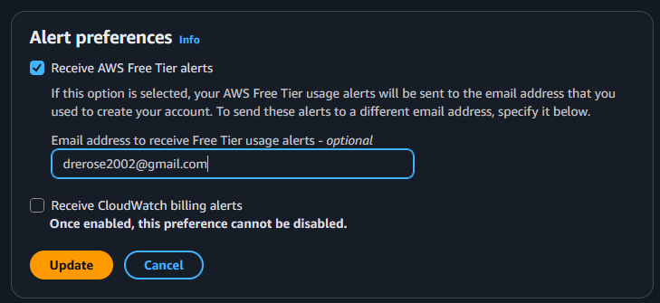
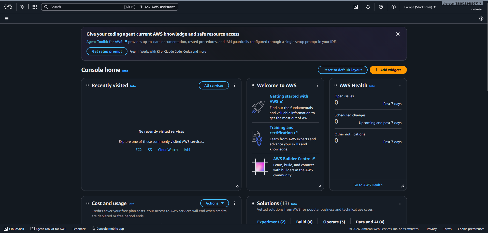
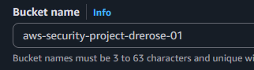
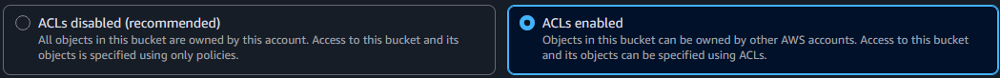
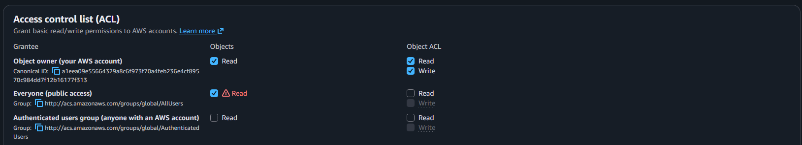
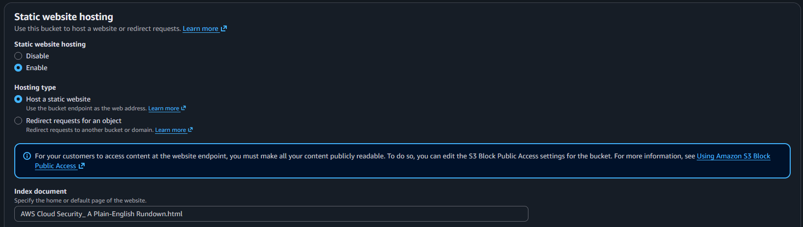
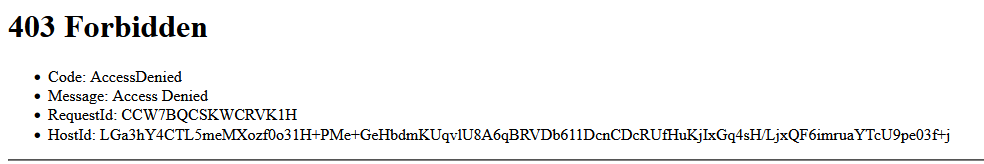
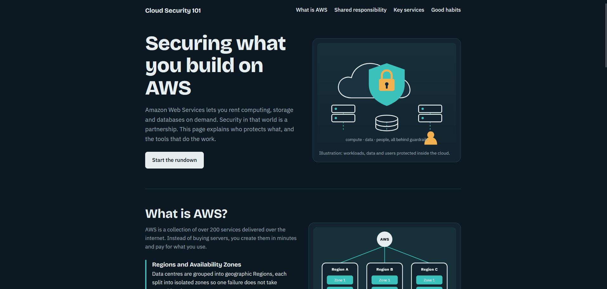

# ☁️ AWS Cloud Security Project

---

## 🎯 Project Purpose

I've worked with Guard Duty and Cloudtrail logs as part of detection engineering and SIEM work however I havent personally managed any AWS infrustucture. This project is to bridge that gap in my experience by:
- Starting to build skills in AWS by getting used to the platform from an administrative side
- Learning Identity and Access Management (IAM) practices and procedures in AWS
- Gaining more confidence in cloud security

## 🧰 Tools & Methods Used

| Tool / Method | Role in the project |
|---|---|
| **AWS** | Cloud platform (free tier account) |
| **S3 Buckets** | Static website hosting |
| **AWS ACLs** | Object and bucket permissioning |
| **Claude AI** | Generated the static website content |

## 🗺️ Project Stages

| Stage | Description | Status |
|---|---|---|
| 1 | Account setup and billing | ✅ Complete |
| 2 | Hosting a public website using an S3 bucket | ✅ Complete |
| 3 | Setting up IAM | 🚧 To be continued |
| 4 | Creating a Virtual Private Cloud | 🚧 To be continued |
---

## 🔐 Stage 1: Account Setup and Billing

For this project an AWS free tier account was set up in line with security standards, using a secure password and MFA.

### Key steps

- **Set up the account using a secure password** (NIST SP 800-63B compliance)
  - 16 characters long
  - Secured with a password manager (Bitwarden)
  - Reminder set to reset the password in 3 months
- **Enabled two-factor authentication** using a passkey
- **Enabled billing alerts** to ensure no unknown expenditure occurs

### 📸 Evidence

**Setting up billing alerts**

**Main console**

---

## 🪣 Stage 2: Hosting a Public Website Using an S3 Bucket

### Why

I want to learn how to create a basic S3 instance, upload files to it, and how to manage it.

### How

#### Step 1: Creating an S3 bucket

**Considerations**

1. **Suitable naming convention**
   Ensure the name is understandable and suitable for the use case. In this case, it was linked to the project name and my ownership.

   

2. **Access Control Lists (ACLs)**
   I wanted to enable the use of ACLs to build skill around least privilege in the platform and to gain familiarity with permissioning in AWS.

   

3. **Public access**
   For the purposes of this project I wanted public access enabled, again to get used to permissions in an S3 bucket.

   > ⚠️ **Note:** I understand that in a production environment this would very rarely be the case.

   

#### Step 2: Generating a static HTML website and uploading it to the S3 bucket

For this step I used Claude to generate a simple static website: a basic rundown of cloud security using AWS.
Claude generated `AWS Cloud Security_ A Plain-English Rundown.html`, which can be viewed in the [`AWS_Project_Files`](AWS_Project_Files) directory in this repository.

**1. Enabling static hosting and identifying the index document**

**2. Identifying the access error**

In this case the object had not yet been configured for public access, so access permissions needed to be adjusted. This is due to ACLs being enabled during bucket setup.

**3. Updating the bucket ACL to allow public read-only access**

Even though this is public and insecure, read-only access at least mitigates the risk as a form of least privilege.

**4. Website publicly available!**

---

## 💡 Lessons Learned

This taught me the basic steps to:

- Create an S3 bucket
- Upload files to it
- Adjust permissions using an ACL
- Troubleshoot basic access permission issues

---

## 🚧 Stage 3: Setting Up IAM

*To be continued...*
